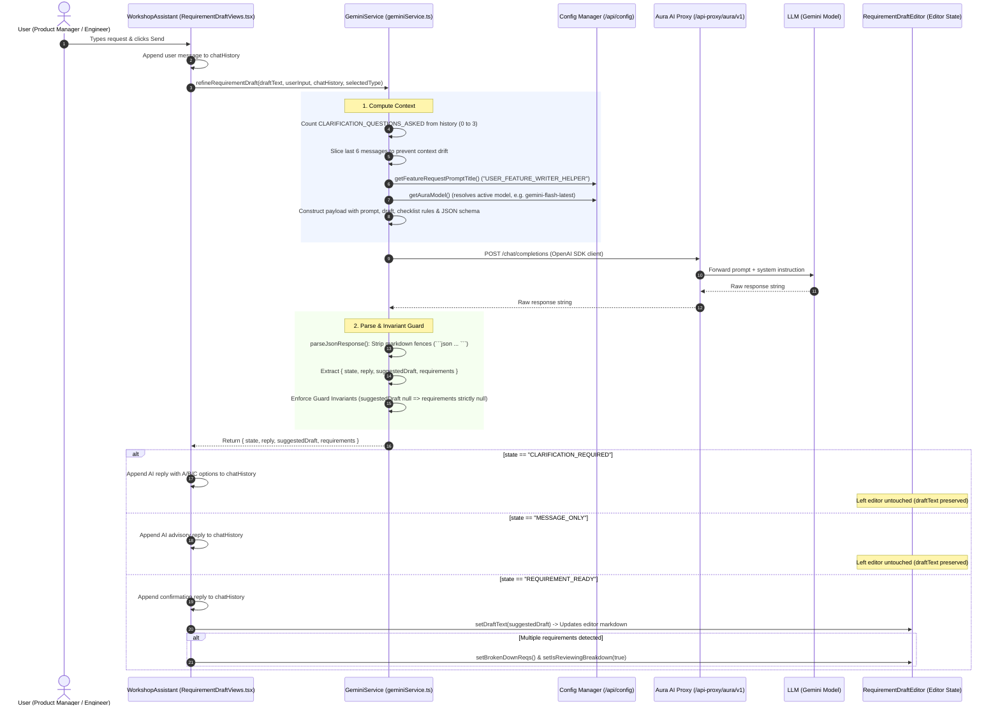
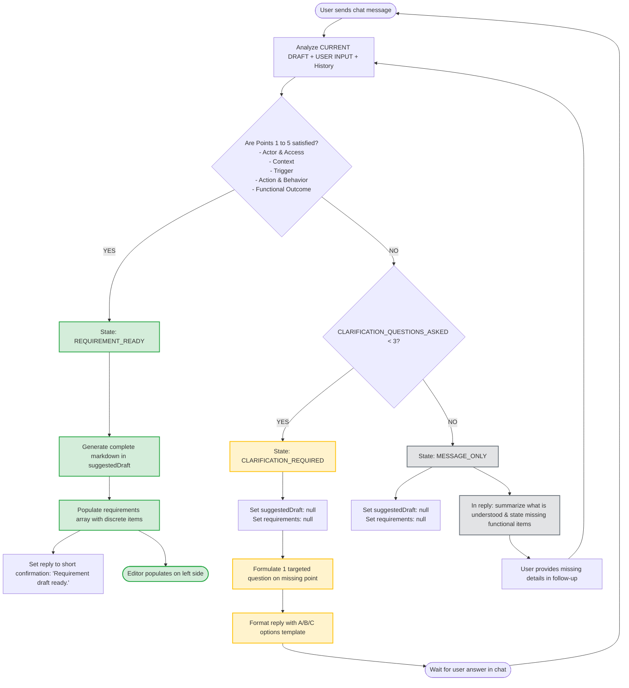
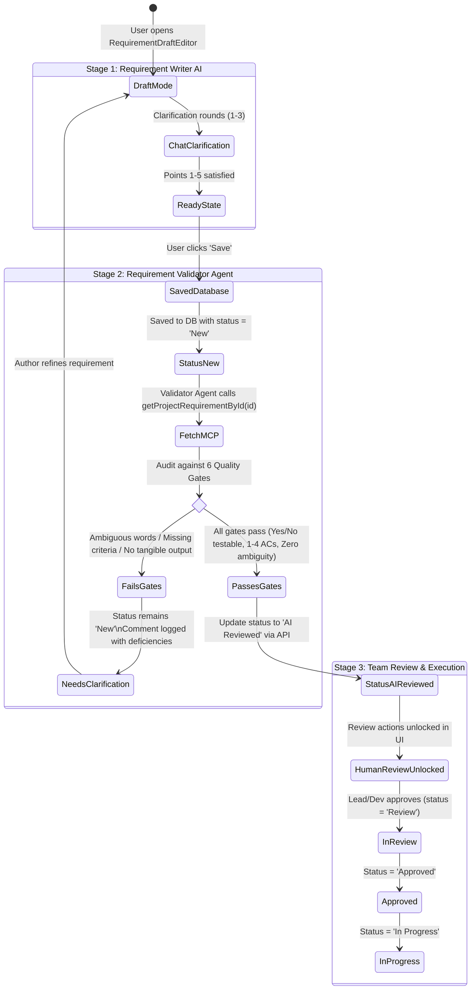
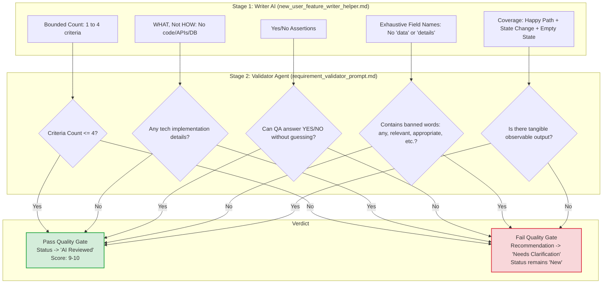

# 📐 AI Requirement Generation: Backend Architecture & Workflow Diagrams

This document illustrates the end-to-end architecture, data flows, state machines, and code paths powering the **AI Requirement Generation** system in `ux_requirement_studio`.

---

## 1. End-to-End System Architecture

---

## 2. Clarification State Machine & Decision Tree

This diagram outlines how the model processes user input against the **6-Point Checklist** and the **3-Question Cap**:

---

## 3. Two-Stage Delivery Pipeline (Writer AI ➔ Validator Agent ➔ Human Review)

This diagram shows how the generated output transitions across database entities and approval quality gates:

---

## 4. Acceptance Criteria Validation Architecture

How the Writer AI's criteria are checked by the Validator Agent's Quality Gate:

---

## 5. Code Directory Reference

| Component / Service | File Path | Role in Architecture |
|---|---|---|
| **Chat Panel UI** | [`components/RequirementDraftViews.tsx`](file:///d:/HIQ/ux_requirement_studio/components/RequirementDraftViews.tsx) | `WorkshopAssistant`: captures chat input, renders chat bubbles, sends turns. |
| **Editor Container** | [`components/RequirementDraftEditor.tsx`](file:///d:/HIQ/ux_requirement_studio/components/RequirementDraftEditor.tsx) | Holds `draftText`, handles multi-requirement breakdown, attachment uploads, and save handler. |
| **AI Service Engine** | [`services/geminiService.ts`](file:///d:/HIQ/ux_requirement_studio/services/geminiService.ts) | Implements `refineRequirementDraft`, manages Aura Proxy connection, JSON parsing, and guard invariants. |
| **System Instruction** | [`new_user_feature_writer_helper.md`](file:///d:/HIQ/new_user_feature_writer_helper.md) | The production prompt template with XML tags, 6-point checklist, and validator compliance. |
| **Validator Prompt** | [`requirement_validator_prompt.md`](file:///d:/HIQ/requirement_validator_prompt.md) | System prompt for the downstream quality auditor. |
| **API Config & Endpoints**| [`services/appBuilder/config.ts`](file:///d:/HIQ/ux_requirement_studio/services/appBuilder/config.ts) | Base URLs for Proxy, Config Manager, and AI Studio Manager. |
