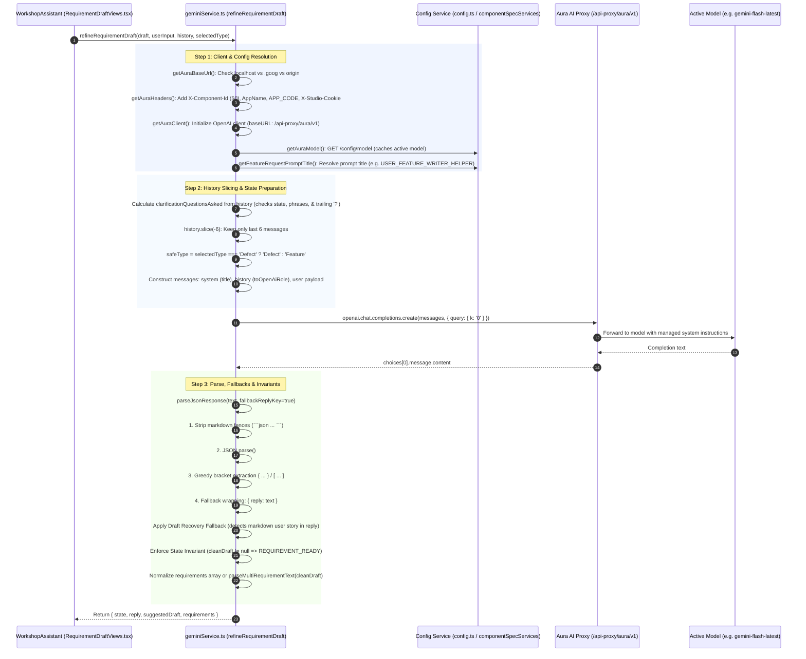
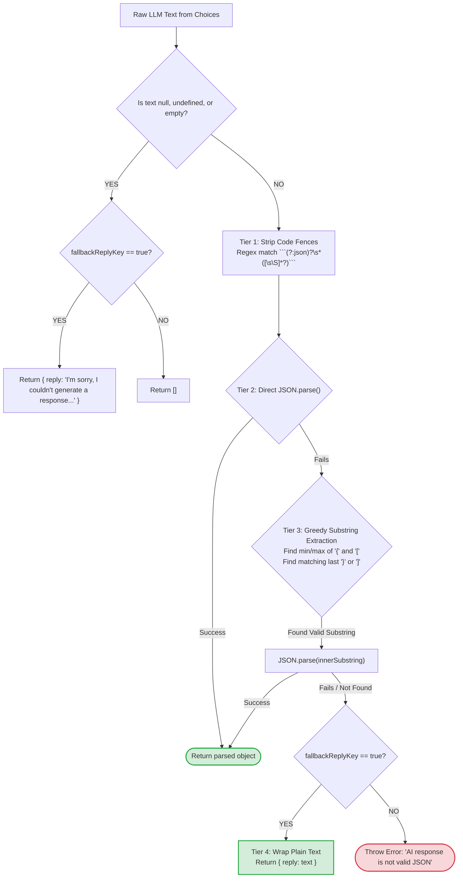

# 📐 Backend Architecture: `geminiService.ts` Deep Dive

This document maps the exact, active implementation of **`services/geminiService.ts`** in `ux_requirement_studio`. It reflects the real code, functions, fallback pipelines, and invariants running in the application.

---

## 1. End-to-End Service Architecture



---

## 2. Actual State Machine in `refineRequirementDraft()`

This flowchart depicts the real branching and guard invariants in `geminiService.ts` (lines 474–615):

```mermaid
flowchart TD
    Start([User sends chat message]) --> CountHistory["Calculate clarificationQuestionsAsked<br/>Counts model messages with:<br/>- state == 'CLARIFICATION_REQUIRED'<br/>- contains 'clarification needed'<br/>- ends with '?' (excluding acceptance criteria)"]
    
    CountHistory --> SliceHistory["Take recentHistory = history.slice(-6)"]
    SliceHistory --> SendPrompt["Dispatch Prompt Payload to Aura Proxy with:<br/>CURRENT DRAFT<br/>SELECTED TYPE<br/>CLARIFICATION_QUESTIONS_ASKED<br/>USER INPUT"]
    
    SendPrompt --> ParseResponse["parseJsonResponse(text, fallbackReplyKey=true)"]
    
    ParseResponse --> CheckDraft{"Is suggestedDraft valid string?<br/>(not empty & not 'null')"}

    CheckDraft -- YES --> CleanDraftSet["cleanDraft = suggestedDraft.trim()"]
    
    CheckDraft -- NO --> ReplyFallback{"Does cleanReply contain complete draft structure?<br/>(User Story + Acceptance Criteria)<br/>AND is not a question"}
    
    ReplyFallback -- YES --> AdoptReply["cleanDraft = cleanReply.trim()<br/>cleanReply = 'Requirement draft ready.'<br/>finalState = 'REQUIREMENT_READY'"]
    
    ReplyFallback -- NO --> CleanDraftNull["cleanDraft = null"]

    CleanDraftSet --> ResolvedReady["resolvedState = 'REQUIREMENT_READY'"]
    AdoptReady --> ResolvedReady

    CleanDraftNull --> CheckFinalState{"finalState == 'CLARIFICATION_REQUIRED'?"}
    CheckFinalState -- YES --> ResolvedClarify["resolvedState = 'CLARIFICATION_REQUIRED'"]
    CheckFinalState -- NO --> ResolvedMsgOnly["resolvedState = 'MESSAGE_ONLY'"]

    ResolvedReady --> ExtractReqs{"Are parsed.requirements present?"}
    ExtractReqs -- YES --> MapReqs["Map to Requirement objects (status: 'New', safeType)"]
    ExtractReqs -- NO --> MultiCheck["parseMultiRequirementText(cleanDraft, safeType)"]
    MultiCheck -- Multiple Reqs --> SplitReqs["normalizedReqs = split requirements"]
    MultiCheck -- Single Req --> SingleReq["normalizedReqs = null (single draft)"]

    ResolvedClarify --> ForceNullReqs["normalizedReqs = null (Strict Invariant)"]
    ResolvedMsgOnly --> ForceNullReqs

    MapReqs --> ReturnPayload([Return { state, reply, suggestedDraft, requirements }])
    SplitReqs --> ReturnPayload
    SingleReq --> ReturnPayload
    ForceNullReqs --> ReturnPayload

    classDef ready fill:#d4edda,stroke:#28a745,stroke-width:2px;
    classDef clarify fill:#fff3cd,stroke:#ffc107,stroke-width:2px;
    classDef msg fill:#e2e3e5,stroke:#6c757d,stroke-width:2px;

    class ResolvedReady,AdoptReply,CleanDraftSet,MapReqs ready;
    class ResolvedClarify,CheckFinalState clarify;
    class ResolvedMsgOnly,ForceNullReqs msg;
```

---

## 3. Resilient Parsing Pipeline (`parseJsonResponse`)

In `geminiService.ts` (lines 93–139), every AI response goes through a 4-tier parsing filter:



---

## 4. Multi-Requirement Splitting (`parseMultiRequirementText`)

In `geminiService.ts` (lines 632–697), when the AI returns multiple requirements in a single draft:

```mermaid
flowchart TD
    TextIn[Markdown Draft Text] --> DividerCheck{"Contains '---' markdown dividers?"}
    
    DividerCheck -- YES --> SplitDivider["Split by /(?:^|\n)\s*---\s*(?:\n|$)/"]
    SplitDivider --> SectionsExist{Sections count > 1?}
    SectionsExist -- YES --> ProcessSections["For each section:<br/>1. Extract title from line 1 (strip markdown '#')<br/>2. resolveExplicitType(sectionText)<br/>3. status: 'New', priority: 'Medium', category: 'User'"]
    
    DividerCheck -- NO --> PatternCheck{"Matches /(?:^|\n)(?:###?\s*)?Requirement\s+\d+[:\s]/gi?"}
    SectionsExist -- NO --> PatternCheck

    PatternCheck -- YES (Count > 1) --> MatchSplit["Slice text between match start and next match start"]
    MatchSplit --> ProcessPattern["For each section:<br/>1. Clean title: strip 'Requirement N:'<br/>2. resolveExplicitType(sectionText)<br/>3. Return Requirement object"]

    PatternCheck -- NO (<= 1) --> ReturnEmpty["Return [] (Treated as single requirement)"]

    ProcessSections --> ReturnList([Return Requirement[] array])
    ProcessPattern --> ReturnList
    ReturnEmpty --> ReturnList
```

---

## 5. Complete Function Map of `geminiService.ts`

| Exported Function | Lines in Code | Prompt Key / Mechanism | Purpose |
|---|---|---|---|
| `refineRequirementDraft` | 452–619 | Dynamic via `getFeatureRequestPromptTitle()` | Interactive chat-based requirement authoring with 3-question limit and draft recovery. |
| `getRequirementBreakdown` | 199–231 | `FEATURE_PLANNER` | Decomposes a parent requirement into child sub-requirements. |
| `getComponentSpecBreakdown` | 238–296 | `getComponentSpecPromptTitle()` | Decomposes a requirement and maps each specification to an available `ProjectComponent.id`. |
| `getRequirementsResponse` | 299–344 | `REQUIREMENTS_PRODUCT_OWNER` | Full-list requirements assistant supporting cancellation via `AbortSignal`. |
| `getTaskResponse` | 346–391 | `REQUIREMENTS_PRODUCT_OWNER` | Task-level assistant supporting cancellation via `AbortSignal`. |
| `parseRequirementsFromText` | 393–423 | `REQUIREMENTS_FROM_TEXT` | Ingests unstructured meeting notes or PRD text and extracts requirement objects. |
| `generatePRD` | 425–450 | `PRD_FROM_REQUIREMENTS_GENERATOR` | Converts a structured JSON array of requirements into a complete PRD document. |
| `breakdownDraftToRequirements` | 699–737 | `getAiBreakdownPromptTitle()` | Parses an editor draft into normalized `Requirement[]` objects. |
| `parseMultiRequirementText` | 632–697 | Local regex parser (no LLM call) | Splits drafts containing `---` or `Requirement N:` into discrete requirements. |
| `fetchPromptFromManager` | 190–197 | `getPromptByTitle(title)` | Helper to fetch prompt text directly from Prompt Manager API. |
